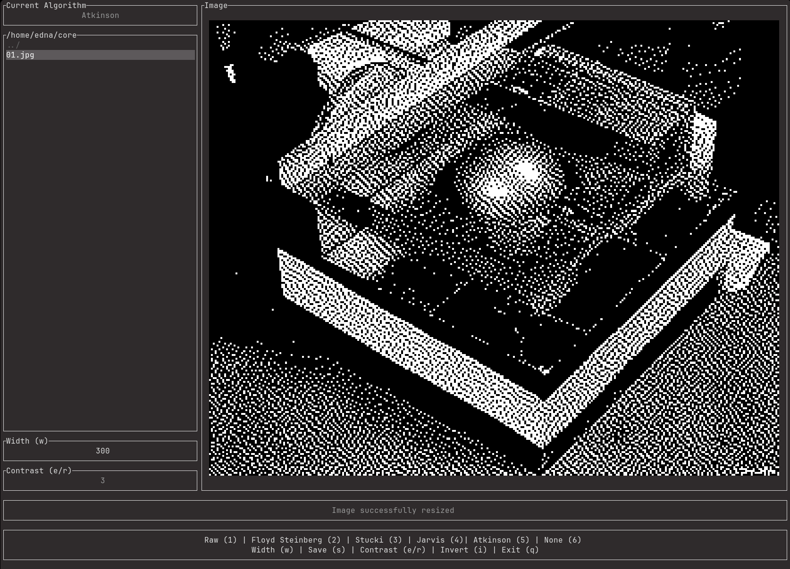

# beg2dither

A TUI for image dithering with live preview.<br>



## Installation

If you do not have Rust installed follow the [instructions](https://rust-lang.org/tools/install/).<br>

### Via crates.io

Install:

```bash
cargo install beg2dither --locked
```

and run:

```bash
b2d
```

### Manual installation

Clone the repository and run in release mode:

``` bash
git clone https://github.com/northernmarshes/beg2dither
cd beg2dither
cargo run --release --locked
```

## Update

If you installed from crates.io you can update.<br>
First install cargo-update:

```bash
cargo install cargo-update
```

And run:

```bash
cargo install-update beg2dither --locked
```

## Algorithms

- Floyd Steinberg
- Stucki
- Jarvis
- Atkinson
- None

## Requirements

For the list of compatible terminal emulators see [ratatui-image](https://github.com/ratatui/ratatui-image).
You are probably going to need to install [chafa](https://hpjansson.org/chafa/download/) to display the preview.

## Disclaimer

Coded by a human - all bugs carefully crafted by hand.
